Here is the complete, clean text architecture specification and step-by-step workflow guide, stripped of all code blocks, formatted clearly for your architecture understanding and documentation review:

# Complete Technical Architecture Specification & Implementation Guide

## Enterprise Agentic Compliance & Governed Data Pipeline

---

## 1. Problem Statement & Enterprise Vision

The Enterprise Agentic Compliance & Governed Data Pipeline acts as an AI-powered security guard and data cleaner for enterprise databases.
Instead of letting an AI agent freely execute commands against a live database (which risks breaking schemas, leaking sensitive data, or causing data loss), this system provides strict guardrails, human approvals, and standardized tool protocols (FastMCP).
🔄 What Happens Step-by-Step (The User Journey)
1. The Request:
2. An internal user or data engineer submits a natural-language command to the web dashboard, such as:
3. "Clean up and standardize the billing address formats for all incoming EU client records in the staging database."
4. Context Routing & PII Sanitization:
5. The system routes the request to a specialized Compliance Agent. Before sending any data to an external LLM, it automatically scans and masks sensitive fields (like PII, phone numbers, or passwords) to prevent data leaks.
6. Plan Generation:
7. The agent analyzes the database schema and writes a structured normalization plan (e.g., a specific batch of data transformations or SQL UPDATE scripts).
8. The Human-in-the-Loop (HITL) Safety Gate:
9. Because the action involves modifying data, the system pauses automatically. It saves its exact state to a database checkpointer and sends a notification to a manager or admin saying:
10. "Agent has prepared a migration plan. Review the proposed changes before execution."
11. Secure Execution via FastMCP:
12. Once the human clicks Approve, the system unpauses and executes the operation through an isolated FastMCP (Model Context Protocol) server. The database engine strictly enforces that only approved, validated queries run, completely blocking accidental deletions or unreviewed writes.
🎯 Why This Project is Valuable
- Bridges AI with Enterprise Safety: It solves the #1 reason enterprises reject AI agents: fear of unreviewed automated side-effects in production.
- Demonstrates Systems Engineering: It shows you don't just know how to call an LLM API, but that you know how to build state machines, secure tool protocols, and audit trails.

### The Core Dilemma

Enterprises are sitting on vast amounts of structured data, but technical teams are bogged down by repetitive data hygiene tasks: standardizing addresses, masking regulatory PII, fixing malformed foreign keys, and running schema updates. While Large Language Models (LLMs) can easily reason through data transformations and write complex SQL scripts, **enterprises overwhelmingly refuse to grant AI agents direct write access to live databases**.

### The Threats of Ungoverned AI Agents

* **Production Schema Corruption:** An LLM generating an unoptimized or syntactically invalid `ALTER TABLE` or `UPDATE` query without explicit `WHERE` conditions can lock tables, drop critical columns, or corrupt millions of rows.
* **Data Leakage & Regulatory Violations:** Passing unmasked customer records to external LLM providers violates strict data privacy frameworks, including GDPR, HIPAA, and CCPA.
* **Loss of Audit Trails:** Traditional autonomous agents operate as "black boxes," leaving security teams unable to trace *why* a data modification occurred, *who* approved it, or *what* the row values were prior to the change.
* **The "Irreversibility" Misconception:** Once a bad transaction commits to a live PostgreSQL or MySQL database, you cannot simply "undo" or "rollback" the database instance without losing all legitimate user transactions that occurred after the event.

### The Solution: A Governed Multi-Agent System (MAS)

The **Enterprise Agentic Compliance & Governed Data Pipeline** solves this problem by acting as an air-gapped, AI-powered security guard and data cleaner. Instead of allowing an LLM to talk directly to a database driver, this system wraps LLM reasoning inside a **4-tier governed state machine**. It enforces strict PII masking prior to LLM processing, subjects proposed migration scripts to automated LLM-as-a-Judge code evaluations, halts execution for cryptographically signed Human-in-the-Loop (HITL) manager approvals, and executes write operations through sandboxed **FastMCP (Model Context Protocol)** servers with transactional savepoints and pre-image audit logging.

---

## 2. Complete End-to-End Visual Architecture (Mermaid.js Flow)

Below is the complete system design mapping out every layer, state transition, and storage tier:

```mermaid
graph LR
    %% =======
    %% CLASS DEFINITIONS
    %% =======
    classDef ui fill:#e1f5fe,stroke:#0288d1,stroke-width:2px;
    classDef supervisor fill:#fff9c4,stroke:#fbc02d,stroke-width:2px;
    classDef agent fill:#e8f5e9,stroke:#388e3c,stroke-width:2px;
    classDef hitl fill:#ffe0b2,stroke:#ef6c00,stroke-width:3px,stroke-dasharray: 6 4;
    classDef persistence fill:#eceff1,stroke:#455a64,stroke-width:2px;
    classDef storage fill:#eceff1,stroke:#455a64,stroke-width:1px,stroke-dasharray: 2 2;
    classDef execute fill:#f3e5f5,stroke:#7b1fa2,stroke-width:2px;

    %% =======
    %% NODES & STYLING
    %% =======
    User[User / Data Engineer] -->|1. Prompt: 'Clean EU Client Data'| UI[Enterprise Data Dashboard]
    UI -->|2. Dispatch Agentic Workflow| Supervisor[A. MASTER ORCHESTRATOR / SUPERVISOR]
    
    %% Guardrail Agent Node
    Supervisor --> AG_Guard[B. GUARDRAIL AGENT]
    AG_Guard -->|3. Presidio NER Scan / Regex Filter| Guardrail_Model(PII Guard Model / NeMo)
    
    %% Compliance Planner Agent Node
    Supervisor --> AG_Compliance[C. COMPLIANCE PLANNER AGENT]
    AG_Compliance -->|4. Schema Context Injection| Schema_Metadata[(PostgreSQL READ-ONLY Schema Mirror)]
    AG_Compliance -->|5. Draft Migration / SQL Plan| Planning_Model(Compliance Planning Model)

    %% Safety Judge Agent Node
    Supervisor --> AG_Judge[D. LLM-as-a-Judge AGENT]
    AG_Judge -->|6. Automated Code Evaluation| Judge_Model(Deterministic Judge Model)

    %% Flow to Gate
    AG_Guard --> Supervisor
    AG_Compliance --> Supervisor
    AG_Judge --> Supervisor
    Supervisor -->|7. Transition to Gate Block| Checkpoint[E. STATE MACHINE / DURABLE CHECKPOINTER]

    %% HITL Human Approval Loop (Safety Net 3: Catching logical errors before execution)
    Checkpoint -.->|8. Pause & Generate Cryptographic Token| HITL_Admin[F. HITL GATE: Human Intent & Error Review]
    HITL_Admin -->|9. Approved Signed Payload| Checkpoint

    %% Gate to Execution
    Checkpoint -->|10. Unpause & Resume Session| AG_Execution[G. EXECUTION WORKER]
    
    %% Safety Net 1: FastMCP Constraints & Dry-Run Transaction
    AG_Execution -->|11. Enforce Constraints: Block DROP / Unfiltered DELETE| FastMCP[H. FastMCP ISOLATED SANDBOX & TRANSACTION]
    
    %% Actual DB & Storage with Safety Net 2: Soft Deletes & Pre-image backups
    FastMCP -->|12. Execute Soft-Delete / Parameterized Updates| ProductionDB[(Production / Staging DB)]
    FastMCP -->|13. Offload Heavy Tool Payloads >5KB| S3Bucket[(S3 Object Storage)]

    %% Redis Hot Tier & Postgres Global State (with Audit Pre-Images)
    UI -.->|Initialize Run Key| Redis_Hot[Redis Hot State / Session TTL]
    Checkpoint --- Postgres[(PostgreSQL Global State & Immutable Audit Pre-Images)]
    
    %% Safety Net 2: Logging Pre-images to Postgres
    FastMCP -.->|14. Snapshot Pre-Images & Log Idempotent State History| Postgres

    %% Apply Classes
    class UI ui;
    class Supervisor supervisor;
    class AG_Guard,AG_Compliance,AG_Judge,AG_Execution agent;
    class Checkpoint,HITL_Admin hitl;
    class Schema_Metadata,ProductionDB,Redis_Hot,Postgres persistence;
    class S3Bucket storage;
    class FastMCP execute;

```

---

## 3. Deep-Dive Architecture Components & Tier Breakdown

### Tier 1: Ingestion & Session Memory Tier (Hot State)

* **Enterprise Data Dashboard (Web UI):** React/Next.js frontend where engineers submit prompts, view execution logs, review proposed migration plans, and approve pending HITL requests.
* **Redis Hot State:** Acts as the low-latency volatile state layer. It stores current active node execution context, agent step counters, and short-term memory keys using a TTL policy (`checkpoint:thread:{thread_id}`). If an agent needs to retry an internal sub-task, it pulls hot context from Redis.

### Tier 2: Agentic Reasoning Cluster (Multi-Agent System)

* **A. Master Orchestrator / Supervisor Agent:** Built on a state machine framework (e.g., LangGraph or Temporal). It acts as the central router, delegating tasks sequentially to worker nodes, managing retry budgets (max 3 retries per sub-task), and controlling state transitions.
* **B. Guardrail Agent (PII Sanitization):** Intercepts all incoming natural language prompts. Utilizes Microsoft Presidio and regex middleware to detect Named Entities (Emails, Phone Numbers, Credit Cards, IBANs, SSNs) and replaces them with cryptographic masks (e.g., `[MASKED_EMAIL_1]`) before passing text to any external LLM.
* **C. Compliance Planner Agent:** Fetches the exact database structure from a **PostgreSQL Read-Only Schema Mirror**. Using this schema, it generates a structured, deterministic JSON migration plan containing parameterized SQL queries or data transformation scripts.
* **D. LLM-as-a-Judge Agent (Automated Security Gate):** Runs a secondary, automated evaluation on the generated plan. It scores the proposed code against a strict security rubric (verifying presence of `WHERE` clauses, detecting prohibited SQL keywords like `DROP`, `TRUNCATE`, or `ALTER`, and verifying syntax correctness). If validation fails, it triggers an internal reflection loop back to Agent C or kills the workflow.

### Tier 3: Governance & Durable Persistence Tier (Warm State)

* **E. Durable Checkpointer:** When a write operation is confirmed safe by Agent D, the graph invokes its checkpointer. The state machine serializes its complete state dictionary (plan, message history, variables) into JSON format and writes it permanently to **PostgreSQL Global State**. The active Python execution thread then *terminates*, freeing server memory.
* **F. Human-in-the-Loop (HITL) Gate:** A webhook alerts an administrator. The system generates a stateless HMAC-SHA256 cryptographically signed JWT token bound to `plan_id` and an expiration timestamp. The workflow remains safely frozen until the manager verifies the plan on the dashboard and signs off.
* **PostgreSQL Global State & Audit Logs:** The primary relational database holding system tables: `threads`, `execution_plans`, `agent_executions`, `tool_logs`, and `row_pre_images`.

### Tier 4: Air-Gapped Execution & Cold Storage Tier

* **G. Execution Worker:** Rehydrates the graph state upon cryptographically verified HITL resumption. It acts purely as a deterministic relay, receiving the static, approved plan payload without engaging in further LLM reasoning.
* **H. FastMCP Isolated Sandbox:** An air-gapped Model Context Protocol server running in an isolated Docker container or microVM. It exposes tightly bounded database tools.
* **Production / Staging Database:** The target relational database where approved data cleaning and operations occur.
* **S3 Object Storage:** If a database query returns a payload exceeding 5KB (e.g., 50,000 updated rows or detailed diff logs), the FastMCP server offloads the raw JSON payload to S3 and returns only an S3 URI and a brief summary back to the main state thread.

---

## 4. Complete Step-by-Step Data Flow & Execution Scenarios

### Flow 1: Read-Only / Informational Query Path (Safe-Path Execution)

1. **Submit:** User inputs *"Show me the top 50 active EU client billing addresses"* or *"Can you give me info of this client erika.mustermann@web.de"*.
2. **Init:** Supervisor initializes `thread_id` in Redis.
3. **Guard:** Guardrail Agent verifies prompt, detects entity identifiers (e.g., email address), and generates an anonymized token (e.g., `[MASKED_EMAIL_ADDRESS_1]`).
4. **Context:** Compliance Planner fetches schema columns (`full_name`, `email`, `phone`, `billing_address`, `country_code`, etc.).
5. **Generate:** Planner generates a parameterized `SELECT` query: `SELECT id, full_name, email, phone, billing_address, city, country_code, gdpr_consent FROM clients WHERE email = '[MASKED_EMAIL_ADDRESS_1]' AND is_deleted = FALSE;`.
6. **Code Evaluation:** Safety Judge verifies query is strictly read-only (`SELECT`), validates absence of DDL/DML mutation keywords, and passes evaluation.
7. **HITL Review / Fast-Path Execution:** Plan is presented to the operator. Upon execution, the Execution Worker re-maps masked tokens back to their raw values.
8. **Sandboxed Execution via FastMCP:** The Execution Worker dispatches the read query to FastMCP's `/tools/dry-run` sandbox, which executes it inside a read-only transaction on Staging DB without mutating any rows.
9. **Result Capture & Audit Persistence:** FastMCP returns matched rows (`preview_sample`). The Execution Worker persists them into `AgentExecution.agent_output["query_results"]` with `is_read_only = true` and `affected_rows = 0`.
10. **UI Record Presentation:** The Cockpit completion card and the Execution Audit & State Diff modal render a dedicated **"📋 Retrieved Records / Query Output"** table displaying the retrieved CRM entity attributes and a badge confirming 0 database mutations (no rollback snapshots needed). If payload > 5KB, uploads to S3/MinIO and provides an offloaded preview URI.

### Flow 2: Data Cleaning / Write Query Path (Full Governed Pipeline)

1. **Submit:** User inputs *"Clean up and standardize the billing address formats for all incoming EU client records."*
2. **PII Masking:** Guardrail Agent replaces all embedded customer identifying tokens with anonymized masks.
3. **Plan Draft:** Compliance Planner inspects table schema and drafts a structured normalization plan containing parameterized `UPDATE` statements using standardized ISO address schemas.
4. **Automated Judge Check:** LLM-as-a-Judge scans the plan:
* Confirms `UPDATE clients SET billing_address = ... WHERE country_code = 'EU' AND status = 'PENDING';` contains strict `WHERE` constraints.
* Confirms absence of destructive commands (`DROP`, `DELETE`). Passes evaluation.

5. **State Freeze & Checkpoint:** State Machine serializes state dictionary to `execution_plans` table in PostgreSQL. Session state changes to `PENDING_APPROVAL`. Server halts the process thread.
6. **Notification:** Webhook fires to Slack / Admin Dashboard with a cryptographically signed approval token link (`[https://admin.enterprise.com/approve?token=eyJ](https://admin.enterprise.com/approve?token=eyJ)...`).
7. **Human Approval:** Manager clicks "Approve." Dashboard posts the signed token back to the API. Backend verifies token signature against system secret key and unpauses state machine.
8. **Execution & Dry-Run Transaction:**
* Execution Worker rehydrates session from PostgreSQL state.
* Hands payload to FastMCP Sandbox.
* FastMCP opens a database transaction (`BEGIN TRANSACTION`).
* **Pre-Image Capture:** FastMCP queries affected rows and writes their *original* state into `row_pre_images` in PostgreSQL.
* FastMCP executes parameterized updates.
* Validation assertions verify updated rows match address regex standards.
* Transaction issues `COMMIT`.

9. **Audit Log Sealing:** Execution summary, row counts, user IDs, and timestamp hashes are sealed in `tool_logs`. UI displays completion status to user.

---

## 5. Production Safety Nets: Rollbacks, Pre-Images, and Constraints

When asked how the pipeline handles catastrophic errors or user requests to "undo" a committed change, the architecture enforces **Three Production Safety Nets**:

### Safety Net 1: Strict FastMCP Tool Constraints

* FastMCP database drivers do **not** accept arbitrary SQL string blobs from LLMs.
* Tools are declared using strict schema models.
* Destructive statements (`DROP TABLE`, `TRUNCATE`, `DELETE` without primary key parameters) are strictly blocked at the AST (Abstract Syntax Tree) parser level inside the FastMCP server code.

### Safety Net 2: Audit Pre-Images & Soft-Delete Enforcement

* **Why Database Rollbacks Fail in Prod:** Once a transaction commits to a live database, executing a native database engine rollback is impossible without wiping out all unrelated user transactions committed after that point.
* **The Solution (Pre-Images):** Before executing an `UPDATE` or `DELETE`, the FastMCP server executes a `SELECT` snapshot of the target rows. It saves the exact prior row JSON (`pre_image_state`) into PostgreSQL table `row_pre_images` indexed by `execution_id`.
* **Soft-Deletes:** `DELETE` queries are converted under the hood to soft updates: `UPDATE table SET is_deleted = true, deleted_at = NOW()`. Reverting a deletion simply requires flipping `is_deleted = false`.

### Safety Net 3: The Human-in-the-Loop Intent Gate

* The HITL breakpoint is not just a UI button—it is an architectural barrier that separates **Reasoning** from **Side-Effects**.
* It catches semantic and logical errors (e.g., an LLM correctly formatting SQL, but interpreting "EU Clients" as including UK clients when business policy dictates otherwise) before code ever touches production bytes.

---

## 6. Key Architecture Talking Points for Technical Interviews

1. **Deterministic State Checkpointing:** Execution uses externalized PostgreSQL state persistence (`AsyncPostgresSaver`). Active python threads terminate at the HITL breakpoint, preventing memory leaks while waiting for manager approvals.
2. **Cryptographic Approval Tokens:** The approval API requires HMAC-SHA256 signed JWT payloads, preventing spoofing or replay attacks on the resumption webhook.
3. **Pre-Image State Capture:** Solves the "committed data cannot be rolled back" issue by recording row pre-images in PostgreSQL prior to mutation, enabling precise row-level reversibility.
4. **Air-Gapped Tool Protocol (FastMCP):** Keeps tool definitions isolated in a containerized server with strict schema validation, enforcing parameter boundaries over raw LLM code injection.
5. **3-Tier Memory Architecture:** Separates volatile session state (Redis Hot Tier), audit logs and state checkpoints (PostgreSQL Warm Tier), and heavy tool execution payloads >5KB (S3 Cold Tier).

-- Create Enum Types for State Tracking
CREATE TYPE workflow_status AS ENUM ('PENDING_REASONING', 'PENDING_APPROVAL', 'APPROVED', 'REJECTED', 'EXECUTING', 'COMPLETED', 'FAILED');
CREATE TYPE agent_role AS ENUM ('SUPERVISOR', 'GUARDRAIL', 'COMPLIANCE_PLANNER', 'SAFETY_JUDGE', 'EXECUTION_WORKER');

-- 1. Supervisor Thread / Session Table
CREATE TABLE supervisor_threads (
    thread_id UUID PRIMARY KEY DEFAULT gen_random_uuid(),
    user_id VARCHAR(255) NOT NULL,
    master_goal TEXT NOT NULL,
    current_status workflow_status DEFAULT 'PENDING_REASONING',
    created_at TIMESTAMP WITH TIME ZONE DEFAULT CURRENT_TIMESTAMP,
    updated_at TIMESTAMP WITH TIME ZONE DEFAULT CURRENT_TIMESTAMP
);

-- 2. Message History Table
CREATE TABLE message_history (
    message_id UUID PRIMARY KEY DEFAULT gen_random_uuid(),
    thread_id UUID REFERENCES supervisor_threads(thread_id) ON DELETE CASCADE,
    role agent_role NOT NULL,
    content TEXT NOT NULL,
    sanitized_pii BOOLEAN DEFAULT FALSE,
    created_at TIMESTAMP WITH TIME ZONE DEFAULT CURRENT_TIMESTAMP
);

-- 3. Execution Plan & Checkpoint Table
CREATE TABLE execution_plans (
    plan_id UUID PRIMARY KEY DEFAULT gen_random_uuid(),
    thread_id UUID REFERENCES supervisor_threads(thread_id) ON DELETE CASCADE,
    proposed_sql_plan JSONB NOT NULL,
    judge_score NUMERIC(3,2),
    judge_feedback TEXT,
    approval_token_hash VARCHAR(512),
    status workflow_status DEFAULT 'PENDING_APPROVAL',
    approved_by VARCHAR(255),
    approved_at TIMESTAMP WITH TIME ZONE,
    created_at TIMESTAMP WITH TIME ZONE DEFAULT CURRENT_TIMESTAMP
);

-- 4. Agent Executions Trace Table
CREATE TABLE agent_executions (
    execution_id UUID PRIMARY KEY DEFAULT gen_random_uuid(),
    plan_id UUID REFERENCES execution_plans(plan_id) ON DELETE CASCADE,
    agent_name agent_role NOT NULL,
    sub_task_input JSONB NOT NULL,
    agent_output JSONB,
    retry_count INT DEFAULT 0,
    status workflow_status DEFAULT 'EXECUTING',
    started_at TIMESTAMP WITH TIME ZONE DEFAULT CURRENT_TIMESTAMP,
    completed_at TIMESTAMP WITH TIME ZONE
);

-- 5. Tool Logs & Payload Offloading Table
CREATE TABLE tool_logs (
    log_id UUID PRIMARY KEY DEFAULT gen_random_uuid(),
    execution_id UUID REFERENCES agent_executions(execution_id) ON DELETE CASCADE,
    tool_name VARCHAR(255) NOT NULL,
    input_parameters JSONB NOT NULL,
    output_summary TEXT,
    payload_s3_uri VARCHAR(1024), -- Set if payload > 5KB
    is_dry_run BOOLEAN DEFAULT TRUE,
    execution_status VARCHAR(50) NOT NULL,
    executed_at TIMESTAMP WITH TIME ZONE DEFAULT CURRENT_TIMESTAMP
);

-- 6. Immutable Row Pre-Images (For Safety Net 2 / Reverts)
CREATE TABLE row_pre_images (
    pre_image_id UUID PRIMARY KEY DEFAULT gen_random_uuid(),
    execution_id UUID REFERENCES agent_executions(execution_id) ON DELETE CASCADE,
    target_table VARCHAR(255) NOT NULL,
    primary_key_value VARCHAR(255) NOT NULL,
    pre_image_state JSONB NOT NULL, -- Full row snapshot before update
    created_at TIMESTAMP WITH TIME ZONE DEFAULT CURRENT_TIMESTAMP
);

-- Indexes for High-Performance Queries
CREATE INDEX idx_threads_user ON supervisor_threads(user_id);
CREATE INDEX idx_plans_thread ON execution_plans(thread_id);
CREATE INDEX idx_tool_logs_execution ON tool_logs(execution_id);
CREATE INDEX idx_pre_images_exec ON row_pre_images(execution_id);