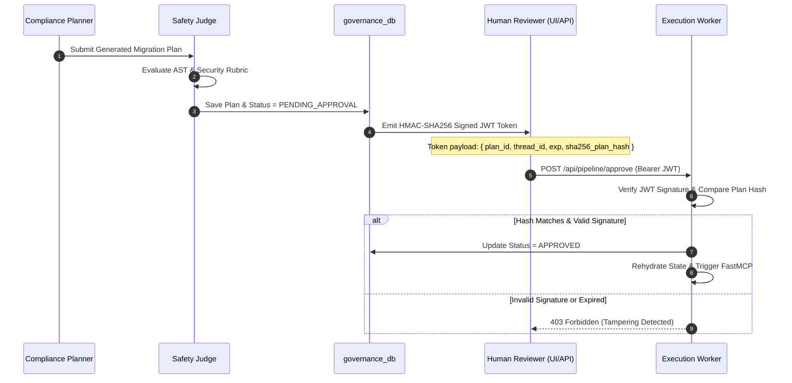

# Enterprise Agentic Compliance Pipeline: Architectural Decision Records (ADR)

This document formalizes the engineering decisions, trade-offs, and technical rationale underpinning the Enterprise Agentic Compliance & Governed Data Pipeline.

---

## 1. System Topology & Architecture Overview

The system isolates non-deterministic LLM reasoning from live production state by introducing a multi-agent governance pipeline, strict AST tool validation, and deterministic cryptographic safety gates.

### High-Level Component Flow

```mermaid
graph LR
    %% =======
    %% CLASS DEFINITIONS
    %% =======
    classDef ui fill:#e1f5fe,stroke:#0288d1,stroke-width:2px;
    classDef supervisor fill:#fff9c4,stroke:#fbc02d,stroke-width:2px;
    classDef agent fill:#e8f5e9,stroke:#388e3c,stroke-width:2px;
    classDef hitl fill:#ffe0b2,stroke:#ef6c00,stroke-width:3px,stroke-dasharray: 6 4;
    classDef persistence fill:#eceff1,stroke:#455a64,stroke-width:2px;
    classDef storage fill:#eceff1,stroke:#455a64,stroke-width:1px,stroke-dasharray: 2 2;
    classDef execute fill:#f3e5f5,stroke:#7b1fa2,stroke-width:2px;

    %% =======
    %% NODES & STYLING
    %% =======
    User[User / Data Engineer] -->|1. Prompt: 'Clean EU Client Data'| UI[Enterprise Data Dashboard]
    UI -->|2. Dispatch Agentic Workflow| Supervisor[A. MASTER ORCHESTRATOR / SUPERVISOR]
    
    %% Guardrail Agent Node
    Supervisor --> AG_Guard[B. GUARDRAIL AGENT]
    AG_Guard -->|3. Presidio NER Scan / Regex Filter| Guardrail_Model(PII Guard Model / NeMo)
    
    %% Compliance Planner Agent Node
    Supervisor --> AG_Compliance[C. COMPLIANCE PLANNER AGENT]
    AG_Compliance -->|4. Schema Context Injection| Schema_Metadata[(PostgreSQL READ-ONLY Schema Mirror)]
    AG_Compliance -->|5. Draft Migration / SQL Plan| Planning_Model(Compliance Planning Model)

    %% Safety Judge Agent Node
    Supervisor --> AG_Judge[D. LLM-as-a-Judge AGENT]
    AG_Judge -->|6. Automated Code Evaluation| Judge_Model(Deterministic Judge Model)

    %% Flow to Gate
    AG_Guard --> Supervisor
    AG_Compliance --> Supervisor
    AG_Judge --> Supervisor
    Supervisor -->|7. Transition to Gate Block| Checkpoint[E. STATE MACHINE / DURABLE CHECKPOINTER]

    %% HITL Human Approval Loop (Safety Net 3: Catching logical errors before execution)
    Checkpoint -.->|8. Pause & Generate Cryptographic Token| HITL_Admin[F. HITL GATE: Human Intent & Error Review]
    HITL_Admin -->|9. Approved Signed Payload| Checkpoint

    %% Gate to Execution
    Checkpoint -->|10. Unpause & Resume Session| AG_Execution[G. EXECUTION WORKER]
    
    %% Safety Net 1: FastMCP Constraints & Dry-Run Transaction
    AG_Execution -->|11. Enforce Constraints: Block DROP / Unfiltered DELETE| FastMCP[H. FastMCP ISOLATED SANDBOX & TRANSACTION]
    
    %% Actual DB & Storage with Safety Net 2: Soft Deletes & Pre-image backups
    FastMCP -->|12. Execute Soft-Delete / Parameterized Updates| ProductionDB[(Production / Staging DB)]
    FastMCP -->|13. Offload Heavy Tool Payloads >5KB| S3Bucket[(S3 Object Storage)]

    %% Data Deletion Lifecycle (30-Day Auto Purge & Admin Hard Delete)
    Cron_Purge[30-Day Retention Job: Automated Cleanup] -->|15. Purge Soft-Deleted Records > 30 Days| ProductionDB
    DBA_Admin[Authorized DBA / Admin] -->|16. Manual Hard-Purge / GDPR Erasure| ProductionDB

    %% Redis Hot Tier & Postgres Global State (with Audit Pre-Images)
    UI -.->|Initialize Run Key| Redis_Hot[Redis Hot State / Session TTL]
    Checkpoint --- Postgres[(PostgreSQL Global State & Immutable Audit Pre-Images)]
    
    %% Safety Net 2: Logging Pre-images to Postgres
    FastMCP -.->|14. Snapshot Pre-Images & Log Idempotent State History| Postgres

    %% Apply Classes
    class UI ui;
    class Supervisor supervisor;
    class AG_Guard,AG_Compliance,AG_Judge,AG_Execution agent;
    class Checkpoint,HITL_Admin,DBA_Admin hitl;
    class Schema_Metadata,ProductionDB,Redis_Hot,Postgres persistence;
    class S3Bucket storage;
    class FastMCP execute;
    class Cron_Purge persistence;

```



---

## 2. Architectural Decision Records (ADRs)

### ADR-001: LangGraph with AsyncPostgresSaver for Workflow Orchestration
- **Status:** Accepted
- **Context:** The system requires multi-agent coordination with conditional branching, reflection loops (when the Safety Judge rejects a plan), and long-running pauses awaiting human authorization.
- **Decision:** Use **LangGraph** with **AsyncPostgresSaver** as the workflow orchestrator.
- **Rationale:** 
  - LangGraph represents workflows as cyclic directed graphs with explicit node states.
  - Native `interrupt()` support allows the process thread to terminate safely upon reaching the approval gate, writing state to PostgreSQL. This prevents idle workers from consuming memory while waiting for human review.
- **Consequences:** All state passed between nodes must be strictly serializable to JSON/JSONB.

---

### ADR-002: Dual-Database Logical Isolation (`governance_db` vs `staging_db`)
- **Status:** Accepted
- **Context:** An AI agent performing data cleaning should never operate within the same database environment where its own logs, plans, and audit snapshots reside.
- **Decision:** Provision two isolated databases on the PostgreSQL instance:
  1. `governance_db`: Houses system state, checkpointer snapshots, execution plans, audit trails, and row pre-images. Accessible only by backend services with write permissions.
  2. `staging_db`: Houses business tables (CRM, client data, invoices). Modifiable exclusively via the isolated FastMCP execution sandbox.
- **Rationale:** Prevents privilege escalation and avoids accidental table locks or metadata contamination during batch data operations.
- **Port Mapping:** The container maps internal port 5432 to host port 5434 to avoid conflicts with native host PostgreSQL services.
- **Consequences:** Cross-database transactions require two-phase coordination handled by the application layer.

---

### ADR-003: Isolated FastMCP Service with AST Validation via `sqlglot`
- **Status:** Accepted
- **Context:** LLMs cannot be trusted with raw database connection strings or unparsed SQL strings. Prompt injections or hallucinated queries could run destructive statements like `DROP TABLE` or `UPDATE` without a `WHERE` clause.
- **Decision:** Run FastMCP in an isolated Docker container exposing explicit tools (`inspect_schema`, `dry_run_plan`, `execute_approved_plan`, `rollback_execution`). Query execution is preceded by mandatory AST parsing via `sqlglot`.
- **Enforced AST Rules:**
  - Strict prohibition of destructive statements: `Drop`, `Truncate`, `Alter`.
  - Mandatory requirement of non-trivial `Where` expressions for all `Update` and `Delete` queries.
  - Conversion of `DELETE` statements into soft deletes (`is_deleted = TRUE, deleted_at = NOW()`).
- **Rationale:** Enforces physical and programmatic boundaries between code generation and code execution.
- **Consequences:** Complex non-standard SQL dialects or multi-statement scripts must parse through `sqlglot` without errors before execution.

---

### ADR-004: Three Production Safety Nets (Pre-Images, AST Guardrails, HITL Gate)
- **Status:** Accepted
- **Context:** Traditional database rollbacks (`ROLLBACK`) fail once a transaction is committed. Restoring a full database snapshot wipes out all valid transactions committed by other users after the snapshot time.
- **Decision:** Implement three deterministic safety layers and a governed deletion lifecycle:
  1. **Safety Net 1 (AST Constraints):** Reject invalid queries prior to execution.
  2. **Safety Net 2 (Row Pre-Images & Soft Deletes):** Prior to mutation, query target rows and save their full pre-change JSON state into `governance_db.row_pre_images`. Reverting a run executes an inverse restore query directly from these pre-images.
  3. **Safety Net 3 (HITL Intent Gate):** Human verification catches business logic flaws that are syntactically valid but operationally incorrect.
- **Data Deletion & Retention Lifecycle:**
  - **AI Agent Constraint:** The AI agent is strictly forbidden from executing hard `DELETE` or `TRUNCATE` operations. All agent deletions are automatically rewritten as soft-deletes (`is_deleted = TRUE, deleted_at = CURRENT_TIMESTAMP`).
  - **30-Day Automated Compliance Purge:** Soft-deleted records reside in a 30-day retention buffer (analogous to an enterprise trash bin). A scheduled infrastructure background job permanently purges rows where `is_deleted = TRUE` and `deleted_at < NOW() - INTERVAL '30 days'` to satisfy GDPR storage limitation mandates.
  - **Admin / DBA Manual Hard-Delete:** Authorized human administrators or DBAs possess manual override privileges to permanently purge records immediately (e.g., in response to an explicit GDPR "Right to be Forgotten" erasure request) via an authenticated admin endpoint or direct database console.
- **Rationale:** Guarantees row-level point-in-time reversibility without database instance downtime, while fulfilling regulatory data disposal obligations.

---

### ADR-005: High-Speed LLM Inference via Groq Free Tier
- **Status:** Accepted
- **Context:** Interactive agent pipelines require low latency for multi-step reasoning (PII scan -> planning -> safety review) to remain usable in real-time environments.
- **Decision:** Standardize on Groq API (`langchain-groq`) using models such as:
  - `llama-3.3-70b-versatile` (Primary Planning & Orchestration)
  - `qwen-2.5-coder-32b` (SQL Synthesis & AST Analysis)
  - `deepseek-r1-distill-llama-70b` (Safety & Compliance Judgement)
- **Rationale:** Delivers enterprise-grade reasoning speed (500+ tokens/sec) within free tier limits, preventing workflow timeouts during multi-turn reflection loops.
- **Consequences:** Strict adherence to context window limits and token rate limits using Redis-based exponential backoff.

---

### ADR-006: 3-Tier Storage Strategy (Hot, Warm, Cold)
- **Status:** Accepted
- **Context:** Database query outputs and diff summaries can range from a few bytes to tens of megabytes. Retaining large payloads in relational state bloats checkpointer snapshots.
- **Decision:**
  - **Hot Tier (Redis 7):** Ephemeral thread metadata, step counters, and rate limits with TTL expiration.
  - **Warm Tier (PostgreSQL):** Relational state, thread lineage, JSON execution plans, and row pre-images.
  - **Cold Tier (MinIO / S3):** Any tool result or diff payload exceeding 5 KB is uploaded to MinIO (`agent-payloads` bucket), returning an S3 URI to the state graph.
- **Rationale:** Keeps LangGraph state dictionaries lightweight and responsive while preserving full payload auditability.

---

### ADR-007: FastMCP Sandbox Containerization & Build Performance Optimization
- **Status:** Accepted
- **Context:** The FastMCP execution sandbox must run in an isolated container on the internal Docker network. Standard Docker builds inside macOS virtualization frequently encounter network throttling during sequential `pip` downloads, and transferring massive local directories (`.venv`) into Docker daemon causes extreme build delays.
- **Decision:**
  1. **Build Context Isolation:** Maintain `.dockerignore` to strictly exclude `.venv/`, `__pycache__/`, `.git/`, and documentation from the Docker build context.
  2. **Multi-Stage Tool Acceleration (`uv`):** Leverage Astral's official `uv` binary (`COPY --from=ghcr.io/astral-sh/uv:latest /uv /bin/uv`) to perform multi-threaded parallel package resolution and wheel installation into the system Python environment.
  3. **Air-Gapped Service Decoupling:** Expose FastMCP as a lightweight FastAPI microservice on container port `8001` interacting exclusively with `governance_db` and `staging_db`.
- **Rationale:** Reduces container build times from >15 minutes down to seconds while guaranteeing reproducible, deterministic tool execution.

---

### ADR-008: Multi-Agent Reasoning, Reversible PII Tokenization & Schema-Aware Planning
- **Status:** Accepted
- **Context:** Large Language Models must not be exposed to raw Customer PII during SQL synthesis, and generated migration queries must strictly adhere to database schemas without hallucinating column names or omitting mutation safety constraints.
- **Decision:**
  1. **Reversible PII Sanitization (Guardrail Agent):** All user input is intercepted by Microsoft Presidio configured with `en_core_web_sm` and custom regex pattern recognizers (EU IBAN, German Tax ID). PII substrings are swapped with deterministic placeholders (`[MASKED_PERSON_1]`, `[MASKED_EMAIL_ADDRESS_1]`) via right-to-left index slicing. The state maintains an isolated `pii_mapping` dictionary never revealed to planning or judge models.
  2. **Schema Introspection & Grounding (Compliance Planner):** The planner queries FastMCP `GET /tools/schema` to ground SQL synthesis on live PostgreSQL column types, constraints, and data previews.
  3. **Guaranteed JSON Object Mode:** The Groq planner model (`qwen/qwen3.8-27b`) is instructed with injected Pydantic `CompliancePlan` JSON schemas via `response_format={"type": "json_object"}`.
  4. **Preservation of Masked Placeholders:** The planner preserves `[MASKED_*]` placeholders in generated SQL WHERE clauses. Unmasking is strictly deferred to the isolated Execution Worker right before FastMCP execution.
- **Rationale:** Ensures zero raw PII leakage to third-party LLM inference APIs while guaranteeing syntactically valid, schema-accurate SQL plans.

---

### ADR-009: Actor-Critic Reflection Loop & Infinite Loop Prevention (Circuit Breaker)
- **Status:** Accepted
- **Context:** If a generated SQL plan violates AST security constraints (missing WHERE clause, tautological 1=1, hard deletes, destructive DDL) or security rubrics, the agent cluster must not crash or loop infinitely.
- **Decision:**
  1. **Self-Correction Feedback Loop (Attempt 1 to 2):** When the Safety Judge rejects a plan, it compiles deterministic AST rule violations and semantic critiques into `judge_evaluation.feedback`. It increments `replan_count` in the graph state and transitions status to `PENDING_REASONING`, routing back to `planner_node`.
  2. **Error Feedback Injection:** When `planner_node` detects `replan_count > 0`, it extracts `judge_eval.feedback` and injects it directly into the LLM prompt:
     `"IMPORTANT: Your previous plan was REJECTED by the Safety Judge with this feedback: {feedback_history}. Please correct all safety and compliance violations mentioned above."`
  3. **Hard Circuit Breaker (`replan_count >= 3`):** If the planner fails to generate a safe plan after 3 consecutive iterations, the Safety Judge marks the state as `status = "FAILED"`, emits a terminal error message, and `route_after_judge` routes directly to LangGraph `END`. This strictly bounds agent execution cost and execution time.
- **Rationale:** Empowers autonomous recovery from minor SQL synthesis mistakes while preventing infinite recursion and unbounded LLM API expenditures.

---

### ADR-010: Hybrid In-Memory & Redis Pub/Sub Event Streaming (`ThreadEventBroadcaster`)
- **Status:** Accepted
- **Context:** Clients monitoring the multi-agent pipeline via Server-Sent Events (SSE) require real-time node transition events even if they connect after reasoning has commenced.
- **Decision:** Implement `ThreadEventBroadcaster` combining Redis list buffers (`pipeline:events:{thread_id}`) for event replay with Redis Pub/Sub channels (`pipeline:channel:{thread_id}`) for real-time live events, falling back gracefully to in-memory queues when Redis is in standalone test mode.
- **Rationale:** Ensures zero dropped events for late-connecting clients and UI inspectors.

---

### ADR-011: Automated End-to-End Governance & Reversibility Verification
- **Status:** Accepted
- **Context:** Unit tests alone cannot prove that cryptographic authorization, live FastMCP sandboxes, pre-image capturing, and database rollbacks work harmoniously across isolated process boundaries.
- **Decision:** Build a unified continuous integration test suite (`backend/tests/test_e2e_pipeline.py`) validating the entire 12-step lifecycle:
  1. Dirty CRM record seeding in `staging_db`
  2. Natural language prompt ingestion via `POST /api/pipeline/run`
  3. Server-Sent Events (SSE) streaming verification
  4. Presidio PII anonymization and schema-grounded planning
  5. Safety Judge evaluation ($\ge 0.85$) and graph pause at the HITL gate
  6. Pending plan inspection and SHA-256 plan hash computation
  7. Negative security testing: rejection of tampered tokens with HTTP 403 Forbidden
  8. Legitimate HMAC-SHA256 JWT authorization submission via `POST /api/pipeline/approve`
  9. Resumption through LangGraph checkpointer and FastMCP execution
  10. Pre-image capture verification in `governance_db.row_pre_images`
  11. 1-Click Rollback restoration via `POST /api/pipeline/{execution_id}/rollback`
  12. Automated 30-day compliance retention purge and GDPR Article 17 Right to Erasure
- **Rationale:** Guarantees absolute regulatory compliance, enterprise reversibility, and end-to-end correctness.

---

## 3. Cryptographic HITL Protocol

The approval gate prevents unauthorized workflow resumption using stateless cryptographic verification:



---

## 4. Database Schemas

### Governance Database (`governance_db`)

```sql
CREATE TYPE workflow_status AS ENUM (
    'PENDING_REASONING',
    'PENDING_APPROVAL',
    'APPROVED',
    'REJECTED',
    'EXECUTING',
    'COMPLETED',
    'ROLLED_BACK',
    'FAILED'
);

CREATE TYPE agent_role AS ENUM (
    'SUPERVISOR',
    'GUARDRAIL',
    'COMPLIANCE_PLANNER',
    'SAFETY_JUDGE',
    'EXECUTION_WORKER'
);

CREATE TABLE supervisor_threads (
    thread_id UUID PRIMARY KEY DEFAULT gen_random_uuid(),
    user_id VARCHAR(255) NOT NULL,
    master_goal TEXT NOT NULL,
    current_status workflow_status DEFAULT 'PENDING_REASONING',
    created_at TIMESTAMP WITH TIME ZONE DEFAULT CURRENT_TIMESTAMP,
    updated_at TIMESTAMP WITH TIME ZONE DEFAULT CURRENT_TIMESTAMP
);

CREATE TABLE message_history (
    message_id UUID PRIMARY KEY DEFAULT gen_random_uuid(),
    thread_id UUID REFERENCES supervisor_threads(thread_id) ON DELETE CASCADE,
    role agent_role NOT NULL,
    content TEXT NOT NULL,
    sanitized_pii BOOLEAN DEFAULT FALSE,
    created_at TIMESTAMP WITH TIME ZONE DEFAULT CURRENT_TIMESTAMP
);

CREATE TABLE execution_plans (
    plan_id UUID PRIMARY KEY DEFAULT gen_random_uuid(),
    thread_id UUID REFERENCES supervisor_threads(thread_id) ON DELETE CASCADE,
    proposed_sql_plan JSONB NOT NULL,
    judge_score NUMERIC(3,2),
    judge_feedback TEXT,
    approval_token_hash VARCHAR(512),
    status workflow_status DEFAULT 'PENDING_APPROVAL',
    approved_by VARCHAR(255),
    approved_at TIMESTAMP WITH TIME ZONE,
    created_at TIMESTAMP WITH TIME ZONE DEFAULT CURRENT_TIMESTAMP
);

CREATE TABLE agent_executions (
    execution_id UUID PRIMARY KEY DEFAULT gen_random_uuid(),
    plan_id UUID REFERENCES execution_plans(plan_id) ON DELETE CASCADE,
    agent_name agent_role NOT NULL,
    sub_task_input JSONB NOT NULL,
    agent_output JSONB,
    retry_count INT DEFAULT 0,
    status workflow_status DEFAULT 'EXECUTING',
    started_at TIMESTAMP WITH TIME ZONE DEFAULT CURRENT_TIMESTAMP,
    completed_at TIMESTAMP WITH TIME ZONE
);

CREATE TABLE tool_logs (
    log_id UUID PRIMARY KEY DEFAULT gen_random_uuid(),
    execution_id UUID REFERENCES agent_executions(execution_id) ON DELETE CASCADE,
    tool_name VARCHAR(255) NOT NULL,
    input_parameters JSONB NOT NULL,
    output_summary TEXT,
    payload_s3_uri VARCHAR(1024),
    is_dry_run BOOLEAN DEFAULT TRUE,
    execution_status VARCHAR(50) NOT NULL,
    executed_at TIMESTAMP WITH TIME ZONE DEFAULT CURRENT_TIMESTAMP
);

CREATE TABLE row_pre_images (
    pre_image_id UUID PRIMARY KEY DEFAULT gen_random_uuid(),
    execution_id UUID REFERENCES agent_executions(execution_id) ON DELETE CASCADE,
    target_table VARCHAR(255) NOT NULL,
    primary_key_value VARCHAR(255) NOT NULL,
    pre_image_state JSONB NOT NULL,
    created_at TIMESTAMP WITH TIME ZONE DEFAULT CURRENT_TIMESTAMP
);

CREATE INDEX idx_threads_user ON supervisor_threads(user_id);
CREATE INDEX idx_plans_thread ON execution_plans(thread_id);
CREATE INDEX idx_tool_logs_execution ON tool_logs(execution_id);
CREATE INDEX idx_pre_images_exec ON row_pre_images(execution_id);
```

### Staging CRM Database (`staging_db`)

```sql
CREATE TABLE clients (
    id UUID PRIMARY KEY DEFAULT gen_random_uuid(),
    full_name VARCHAR(255) NOT NULL,
    email VARCHAR(255),
    phone VARCHAR(50),
    billing_address TEXT,
    postal_code VARCHAR(20),
    city VARCHAR(100),
    country_code VARCHAR(10),
    gdpr_consent BOOLEAN DEFAULT FALSE,
    consent_date DATE,
    status VARCHAR(50) DEFAULT 'PENDING',
    is_deleted BOOLEAN DEFAULT FALSE,
    deleted_at TIMESTAMP WITH TIME ZONE,
    created_at TIMESTAMP WITH TIME ZONE DEFAULT CURRENT_TIMESTAMP,
    updated_at TIMESTAMP WITH TIME ZONE DEFAULT CURRENT_TIMESTAMP
);

CREATE TABLE invoices (
    id UUID PRIMARY KEY DEFAULT gen_random_uuid(),
    client_id UUID REFERENCES clients(id),
    amount_raw VARCHAR(50),
    amount_standardized NUMERIC(12, 2),
    currency VARCHAR(10),
    invoice_date DATE,
    is_deleted BOOLEAN DEFAULT FALSE,
    deleted_at TIMESTAMP WITH TIME ZONE,
    created_at TIMESTAMP WITH TIME ZONE DEFAULT CURRENT_TIMESTAMP
);
```

---

### ADR-012: Next.js App Router Frontend Architecture & Vanilla CSS Design System
- **Status:** Accepted
- **Context:** An enterprise compliance pipeline requires an operator cockpit to visualize multi-agent reasoning, inspect and cryptographically sign execution plans, explore staging records with dirty-data quality badges, and inspect pre-image state diffs with 1-click rollback capabilities.
- **Decision:** Build the frontend using **Next.js (App Router, React 19, TypeScript)** with a bespoke **Vanilla CSS Design System** (no Tailwind dependency) following modern web guidelines:
  1. **Enterprise Design System (`globals.css`):** Dark enterprise aesthetic (`#0B0F19` background, `#1E293B` translucent cards, cyan `#38BDF8` accents, amber `#F59E0B` for HITL alerts, and emerald `#22C55E` for verified execution). Includes subtle micro-animations, glassmorphism, responsive grid breakpoints, and Google Fonts Inter and Outfit.
  2. **Reactive SSE Hook (`usePipeline`):** Subscribes to `/api/pipeline/{thread_id}/stream` to handle server-sent events (`pipeline_started`, `node_guardrail_completed`, `node_planner_completed`, `node_judge_completed`, `hitl_paused`, `completed`, `failed`). Displays real-time node stage progressions, PII redaction counters, planner retry counts (up to 3 attempts), and LLM Judge scores.
  3. **Native `<dialog>` Modals:** Uses the native HTML `<dialog>` element with `showModal()`, light-dismiss via `closedby="any"` (with viewport click fallback for older runtimes), backdrop blur, and focus containment for the Human-in-the-Loop review modal (`HitlApprovalModal`), Client detail drawer, and Pre-image diff viewer (`PreImageDiffModal`).
  4. **CRM Staging Introspection (`/crm`):** Displays clients and invoices with real-time dirty-data badges (malformed E.164 phone numbers, unstandardized currency strings, non-ISO country codes, missing GDPR consent), live search, pagination, and soft-delete toggle.
  5. **Audit & Rollback Explorer (`/audit`):** Provides a transparent log of all agent executions, judge scores, and pre-image counts with an interactive before-and-after state diff viewer and 1-click deterministic rollback trigger.
  6. **Compliance & Retention Console (`/governance`):** Houses the GDPR Article 17 "Right to be Forgotten" permanent hard-delete console and automated 30-day retention horizon purge controls.
- **Consequences:** Provides a high-fidelity, auditable user experience for compliance officers and data engineers without third-party styling library overhead.

---

### ADR-013: Administrative Authentication & Session Security (PBKDF2-HMAC-SHA256 & JWT Bearer)
- **Status:** Accepted
- **Context:** Administrative capabilities (GDPR Article 17 hard-deletions, 30-day retention horizon purges, demo database seeding, and execution approvals) require authenticated identity verification to ensure only authorized compliance officers can execute privileged operations.
- **Decision:** Implement a dual-layer cryptographic authentication architecture across backend and frontend:
  1. **Backend Authentication Layer (`backend/app/api/auth.py`):**
     - Endpoint `POST /api/auth/login`: Authenticates administrative credentials against configurable environment parameters with constant-time password verification (`secrets.compare_digest`) and PBKDF2-HMAC-SHA256 salt hashing.
     - Token Generation (`create_access_token`): Signs an HMAC-SHA256 JWT containing identity claims (`sub`, `email`, `role: "admin"`, `exp`, `iat`, `iss`).
     - Guard Dependency (`get_current_admin`): Extracts and validates the `Authorization: Bearer <token>` header, enforcing privilege checks and rejecting expired or forged tokens with HTTP 401/403.
     - Endpoint `GET /api/auth/me`: Verifies active session tokens and returns verified administrator profile metadata.
  2. **Frontend Authentication Context & UI (`frontend/src/context/AuthContext.tsx`, `frontend/src/app/login/page.tsx`):**
     - Global React `AuthContext` managing reactive session state, local storage synchronization, and transparent bearer token attachment in `api.ts`.
     - **Strict Application Lockdown (`AppShell.tsx`):** Unauthenticated visitors cannot access any application pages (`/`, `/crm`, `/audit`, `/governance`). Any unauthenticated navigation is intercepted and redirected immediately to `/login`.
     - Dedicated `/login` page with dark glassmorphism styling, credential validation, one-click demo credentials auto-fill, and instant session routing.
     - Dynamic Topbar integration displaying the verified administrative identity badge and a one-click session termination ("Sign Out") trigger.
- **Consequences:** Restricts administrative operations to verified operators, provides auditable user attribution for compliance reports, and prevents unauthorized triggers or data inspection on sensitive staging databases.

---

### ADR-014: Dual-Mode Execution: Read-Only Query Safe-Path & Interactive Record Inspection
- **Status:** Accepted
- **Context:** The multi-agent compliance pipeline was initially designed primarily for data hygiene mutations (`UPDATE`, `DELETE`, GDPR anonymization) accompanied by pre-image snapshots in `governance_db`. When users submit informational or data exploration directives (e.g., *"can you give me info of this client erika.mustermann@web.de"*), the Compliance Planner generates parameterized `SELECT` queries with masked filter tokens. Previously, `SELECT` queries were bypassed during execution because they required no row mutations, causing the Execution Audit modal to show an empty pre-image diff ("0 rows mutated, 0 pre-images saved") without displaying the client's information.
- **Decision:** Establish a dual-mode execution and inspection architecture for read-only informational requests:
  1. **Sandboxed Read Execution (`FastMCP /tools/dry-run`):**
     - When the Execution Worker processes approved `SELECT` queries, it dispatches them to the isolated FastMCP dry-run sandbox endpoint (`POST /tools/dry-run`).
     - FastMCP executes the query within a read-only transaction on `staging_db`, captures the matched records in `preview_sample`, and returns them safely without mutation side-effects.
  2. **Audit State & Output Persistence:**
     - The Execution Worker unmasks PII tokens using the reverse `pii_mapping` and persists the retrieved entity records in `AgentExecution.agent_output["query_results"]`.
     - The execution completes with `affected_rows = 0` and `pre_images_captured = 0`, explicitly flagged as `is_read_only = true`.
  3. **On-the-Fly Historical Query Resolution:**
     - The audit endpoint (`GET /api/audit/executions/{id}`) inspects past executions. If `query_results` was not historically captured in `agent_output` but the query was a read-only `SELECT`, it executes the query dynamically against `staging_db` and populates `query_results` in the response payload.
  4. **Dedicated UI Result Presentation:**
     - In both the Cockpit completion card (`page.tsx`) and the Execution Audit & State Diff modal (`PreImageDiffModal.tsx`), when `query_results` are present, a dedicated **"📋 Retrieved Records / Query Output"** card and tabular view renders the returned CRM entity attributes (Name, Email, Phone, Address, City, GDPR consent, Status).
     - Informational badges and banners clarify that 0 mutations were performed because the operation was read-only, confirming that no rollback snapshots or pre-images were needed.
- **Consequences:** Eliminates operator confusion when asking informational questions, enables end-to-end read-and-inspect workflows alongside data cleaning operations, and ensures complete visibility into queried data while maintaining zero mutation risk.


